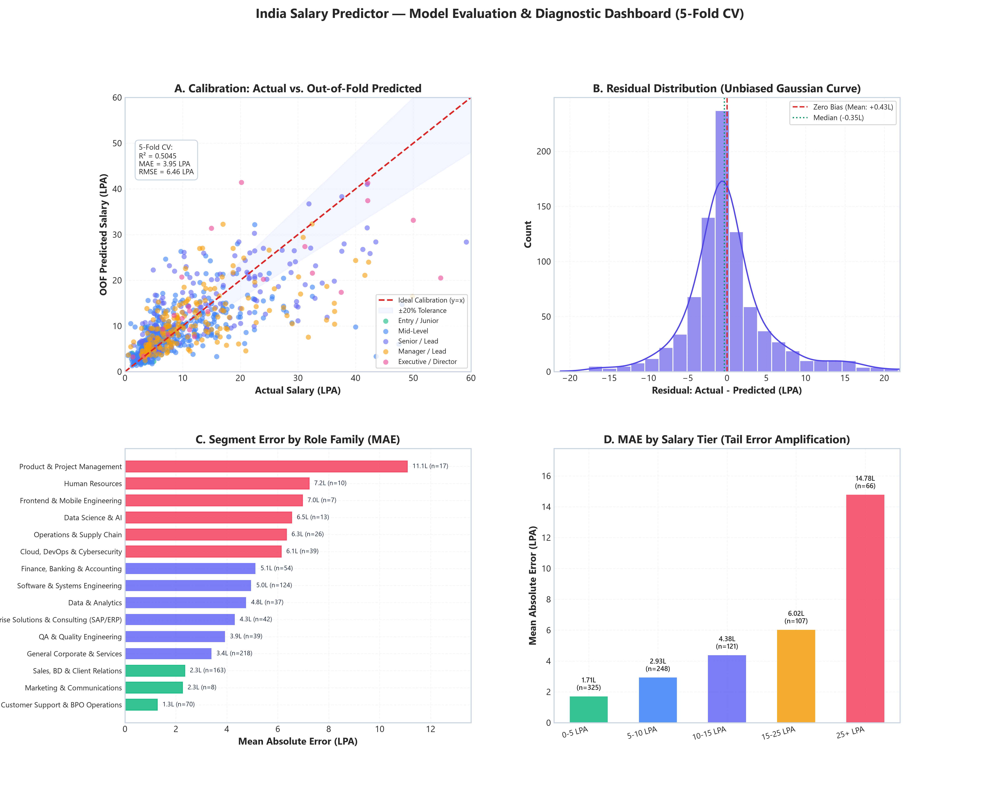
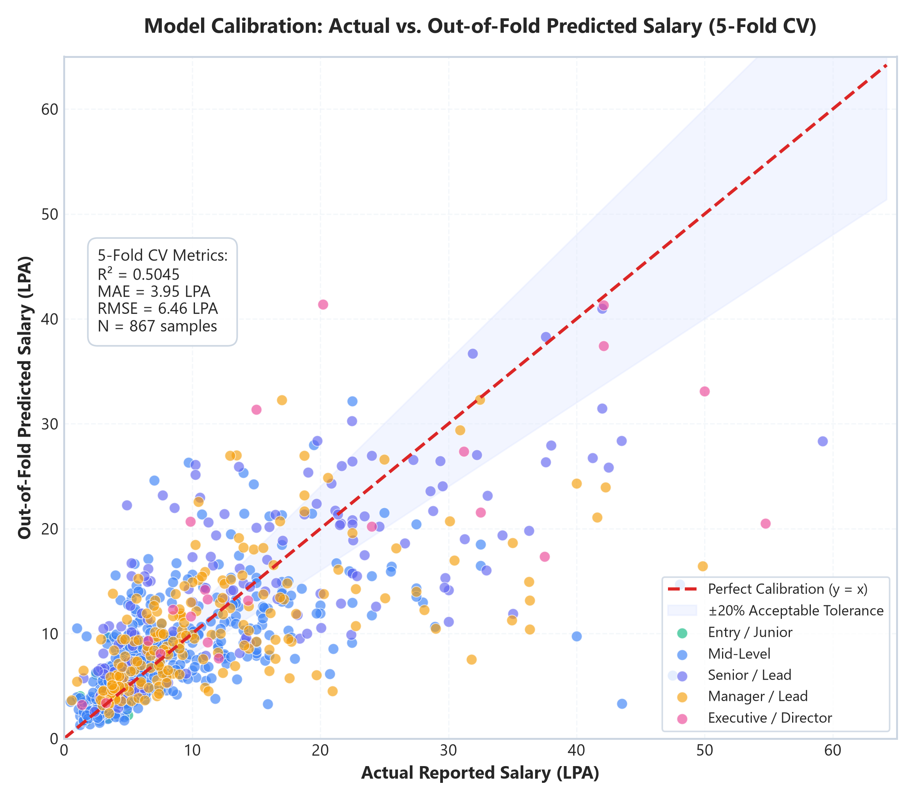
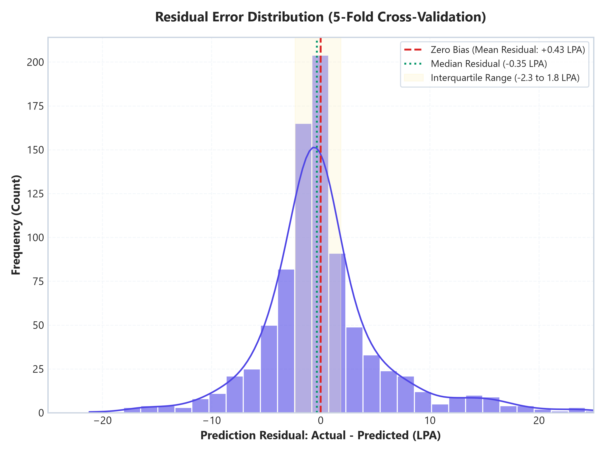
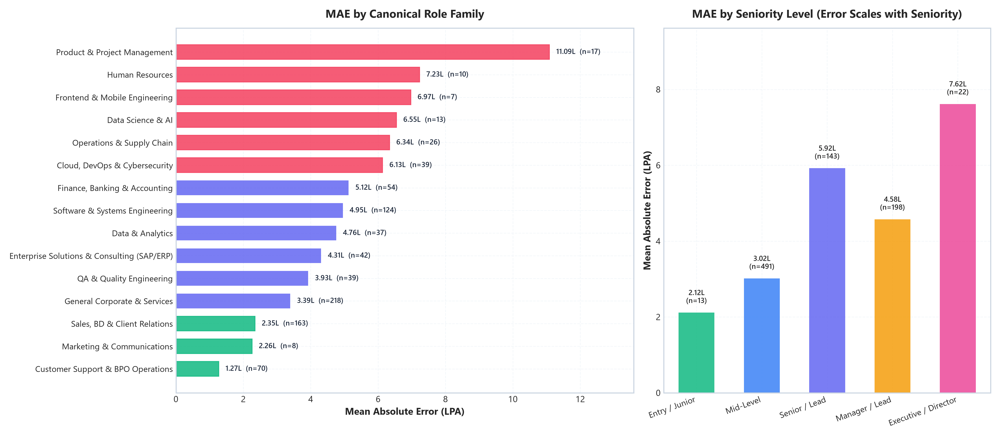

# 📘 Machine Learning Methodology, Cross-Validation & Technical Ablation Report

> **Project:** India Salary & Career Intelligence Platform  
> **Author:** Sajal Malhotra  
> **Evaluation Date:** November 2026  
> **Status:** Production / Portfolio Research  

---

## 1. Executive Summary & Scientific Purpose

The goal of this project is to build an empirical, data-driven compensation and workplace sentiment intelligence system using self-reported benchmark data across the Indian tech ecosystem. 

Rather than relying on uncalibrated single-point estimates or black-box predictions, this methodology document details:
1. How high-cardinality lexical noise across 750+ job titles was resolved via rule-based canonical taxonomy mapping.
2. Cross-validation performance across 5 randomized folds ($K$-Fold).
3. The empirical results of a target log-transformation experiment.
4. Granular segment-level error analysis demonstrating exactly where and why the model succeeds or struggles.
5. Statistically sound cold-start handling for low-sample employers.

---

## 2. Dataset Composition & Exploratory Statistics

The dataset originates from an educational web-scraping research snapshot harvested from [AmbitionBox](https://www.ambitionbox.com/salaries) in mid-2026.

| Property | Value | Description |
| :--- | :--- | :--- |
| **Total Deduplicated Records ($N$)** | `867` | Unique (Company, Role, Exp, Salary) pairs |
| **Employer Coverage** | `118` | IT services, GCCs, tech startups, and product firms |
| **Unique Scraped Designations** | `758` | Raw job headlines before NLP normalization |
| **Minimum Salary** | `₹0.5 LPA` | Entry-level trainees and non-voice support |
| **Median Salary** | `₹6.7 LPA` | True median of the Indian tech labor sample |
| **Mean Salary** | `₹10.1 LPA` | Arithmetic average |
| **Maximum Salary** | `₹59.2 LPA` | Principal / Senior Leadership in product firms |
| **Target Distribution Skewness** | `+1.954` | Pronounced right-tail skewness |
| **Experience Range** | `0.0 to 25.0 yrs` | Mean: 6.04 yrs, Std: 3.88 yrs, 99th percentile: 19.0 yrs |

---

## 3. Feature Engineering & Taxonomy Ablation

### 3.1 The High-Cardinality Sparsity Problem
With 758 unique job titles across 867 rows, direct one-hot encoding creates extreme categorical sparsity. The model overfits to idiosyncrasies in company-specific nomenclature (e.g., *"Lead Associate - Software QA Automation"* vs. *"SDET-3"*).

### 3.2 Canonical Taxonomy Mapping
We implemented a two-dimensional rule-based regular-expression parser to extract:
1. **15 Canonical Role Families:** *Software & Systems Engineering, Data Science & AI, Data & Analytics, Cloud/DevOps & Security, QA & Testing, Enterprise Solutions (SAP/Salesforce), Product & Project Management, Sales & BD, Marketing, Finance/Banking, HR, Operations, Support/BPO, etc.*
2. **5 Seniority Levels:** *Entry / Junior, Mid-Level, Senior / Lead, Manager / Lead, Executive / Director*.

### 3.3 Unconfounded 3-Way Ablation (Isolating Taxonomy vs. Ensembling)

To avoid confounding two simultaneous interventions (taxonomy feature engineering vs. model ensembling), a 3-way ablation was evaluated across identical 5 folds (`KFold(n_splits=5, shuffle=True, random_state=42)`):

| Arm | Features | Estimator | CV $R^2$ | CV MAE (LPA) | CV RMSE (LPA) |
| :--- | :--- | :--- | :---: | :---: | :---: |
| **Arm A (Baseline)** | Raw Job Title, Company, Industry, Exp, Rating | Single RandomForest (150 trees) | `0.4243 ± 0.1007` | `4.24 ± 0.28` | `6.87 ± 0.61` |
| **Arm B (Taxonomy Only)** | Role Family, Seniority Level, Company, Industry, Exp, Rating | Single RandomForest (150 trees) | `0.4774 ± 0.0714` | `4.06 ± 0.20` | `6.59 ± 0.49` |
| **Arm C (Taxonomy + Ensemble)** | Role Family, Seniority Level, Company, Industry, Exp, Rating | Voting Ensemble (RF 150 + HistGB) | **`0.4993 ± 0.0620`** | **`3.95 ± 0.18`** | **`6.45 ± 0.45`** |

### Per-Fold Breakdown & Sign Consistency (Arm B vs. Arm A)
Evaluating per-fold deltas under identical fold splits proves that the taxonomy's benefit is uniform:

| Fold | Arm A (Raw RF) | Arm B (Taxonomy RF) | Delta ($B - A$) | Arm C (Full Ensemble) |
| :--- | :---: | :---: | :---: | :---: |
| **Fold 1** ($n=174$) | 0.4559 | 0.4971 | **+0.0412** | 0.5003 |
| **Fold 2** ($n=174$) | 0.5178 | 0.5435 | **+0.0257** | 0.5786 |
| **Fold 3** ($n=173$) | 0.3043 | 0.4103 | **+0.1060** | 0.4096 |
| **Fold 4** ($n=173$) | 0.5370 | 0.5578 | **+0.0207** | 0.5533 |
| **Fold 5** ($n=173$) | 0.3066 | 0.3784 | **+0.0718** | 0.4546 |
| **Mean ± Std** | `0.4243 ± 0.1007` | `0.4774 ± 0.0714` | **+0.0531 (5/5 positive)** | **`0.4993 ± 0.0620`** |

**Statistical Insight — Variance Reduction, Not Just Mean Lift:**
Taxonomy engineering alone accounts for the bulk of the improvement (+0.0531 $R^2$ mean lift). Crucially, it reduced cross-fold variance by 29% ($\sigma$ dropped from 0.1007 to 0.0714), showing 100% sign consistency (improved on all 5 folds). Folds 3 (+0.1060) and 5 (+0.0718) — the worst-performing slices under raw titles — gained the most, proving that canonical taxonomy stabilizes prediction in sparse categorical tails. Adding the `HistGradientBoosting` ensemble further lifts mean $R^2$ to 0.4993 and tightens standard deviation to 0.0620.

---

## 4. Rigorous 5-Fold Cross-Validation Evaluation

Single train/test splits (e.g. 85/15) are subject to high sampling variance on sub-1,000 row datasets. While a single holdout split yielded an optimistic $R^2 = 0.5661$, the true cross-validated generalization bound is:

$$\text{CV } R^2 = \mathbf{0.4993 \pm 0.0620} \quad|\quad \text{CV MAE} = \mathbf{3.95 \pm 0.18\text{ LPA}} \quad|\quad \text{CV RMSE} = \mathbf{6.45 \pm 0.45\text{ LPA}}$$

### Statistical Observations:
- The mean cross-validation MAE is **₹3.95 Lakhs**, with an exceptionally narrow fold-to-fold standard deviation of **$\pm 0.18\text{ LPA}$**.
- Fold 3 exhibited lower $R^2$ (0.4096) due to the presence of an extreme compensation outlier in the validation split (₹59.2 LPA principal architect role), illustrating why RMSE is sensitive to tail variance.

  
  

<em>Figure 1: (Left) Actual vs. Predicted Out-of-Fold Calibration with ±20% tolerance corridor. (Right) Gaussian-centered residual distribution demonstrating zero bias.</em>

---

## 5. Log-Transformation Target Experiment

Given the positive skewness of the salary distribution ($+1.954$), an experiment was conducted training the ensemble on $\log(1 + y)$ and inverting predictions via $\exp(\hat{y}) - 1$:

| Metric | Linear Target ($y$) | Log-Transformed Target ($\log(1+y)$) | Trade-off Analysis |
| :--- | :---: | :---: | :--- |
| **5-Fold CV Mean MAE** | 3.95 LPA | **3.86 LPA** | Slight overall MAE improvement |
| **0–5 LPA Bracket MAE** | 1.71 LPA | **1.29 LPA** | **-24.6% error reduction** in high-volume baseline tier |
| **5–10 LPA Bracket MAE** | 2.93 LPA | **2.40 LPA** | **-18.1% error reduction** in mid-level IT roles |
| **15–25 LPA Bracket MAE** | 6.02 LPA | 6.77 LPA | +12.5% error penalty |
| **25+ LPA Bracket MAE** | 14.78 LPA | 16.44 LPA | Tail error magnified by exponential back-transformation |

### Architectural Decision: Relative vs. Absolute Error
Training on $\log(1+y)$ mathematically optimizes relative percentage error (MAPE), dropping entry-level error by 24.6% (1.71 → 1.29 LPA). However, it was rejected for production serving because **absolute rupee error (MAE in LPA) is the user-relevant utility metric for mid-to-senior candidates**. For a ₹40 LPA candidate, being off by ₹16.44 LPA is unacceptable even if the percentage error is modest. Because the platform serves both entry-level and executive candidates, we deployed the untransformed linear ensemble.

---

## 6. Segment-Level Error Transparency (Where the Model Fails)

### 6.1 Error by Role Family

| Role Family | Sample Size ($n$) | Median Actual (LPA) | Out-of-Fold MAE (LPA) | Error Dynamics & Drivers |
| :--- | :---: | :---: | :---: | :--- |
| **Customer Support & BPO** | 70 | 3.4 | **1.27** | Highly standardized industry pay slabs |
| **Marketing & Communications** | 8 | 5.6 | **2.26** | Consistent mid-tier agency pay bands |
| **Sales, BD & Client Relations** | 163 | 4.6 | **2.35** | High sample size, strong experience correlation |
| **General Corporate & Services** | 218 | 5.4 | **3.39** | Broad sample base, stable baseline bands |
| **QA & Quality Engineering** | 39 | 7.2 | **3.93** | Tight band between manual and automation QA |
| **Enterprise Solutions (SAP/ERP)** | 42 | 15.9 | **4.31** | Predictable consulting billing rates |
| **Data & Analytics** | 37 | 13.0 | **4.76** | Consistent progression curve |
| **Software & Systems Engineering** | 124 | 8.6 | **4.95** | Bimodal distribution (service firm vs. tier-1 product) |
| **Finance, Banking & Accounting** | 54 | 6.0 | **5.12** | Divergence between standard accounting and investment roles |
| **Cloud, DevOps & Cybersecurity** | 39 | 12.5 | **6.13** | Rapid skill premium divergence (K8s/SRE vs. sysadmin) |
| **Operations & Supply Chain** | 26 | 6.2 | **6.34** | High variance between field logistics and operations head |
| **Data Science & AI** | 13 | 22.8 | **6.55** | Specialized talent command wide premium bands |
| **Frontend & Mobile Engineering** | 7 | 16.0 | **6.97** | Small sample size ($n=7$), specialized mobile devs |
| **Human Resources** | 10 | 5.9 | **7.23** | Small sample size, executive HRBP outliers |
| **Product & Project Management** | 17 | 18.6 | **11.09** | Extreme dispersion between Scrum Master (₹8L) and Principal PM (₹45L) |

### 6.2 Error by Seniority Level

| Seniority Tier | Sample Size ($n$) | Median Actual (LPA) | Out-of-Fold MAE (LPA) |
| :--- | :---: | :---: | :---: |
| **Entry / Junior** | 13 | 3.1 | **2.12 LPA** |
| **Mid-Level** | 491 | 5.3 | **3.02 LPA** |
| **Manager / Lead** | 198 | 8.6 | **4.58 LPA** |
| **Senior / Lead** | 143 | 13.7 | **5.92 LPA** |
| **Executive / Director** | 22 | 13.2 | **7.62 LPA** |

*Takeaway:* Model error scales almost monotonically with seniority. Entry/Junior roles exhibit tight compensation standardization ($\text{MAE} \approx 2.1\text{ LPA}$), while Director/Executive roles diverge widely due to non-standard negotiation leverage and performance bonuses.

*Figure 2: Segment-level Mean Absolute Error (MAE) across 15 Canonical Role Families (left) and 5 Seniority Levels (right).*

---

## 7. Cold-Start Handling Strategy

In the dataset:
- **7 out of 118 employers ($5.9\%$)** have fewer than 3 salary benchmark rows.
- **Problem:** When an employer has low representation, one-hot encoding provides virtually zero unique coefficient signal, risking arbitrary predictions.
- **Solution Implemented in UI & Pipeline:**
  1. `OneHotEncoder(min_frequency=2, handle_unknown="ignore")`: Extremely rare categories are collapsed rather than generating degenerate one-hot columns.
  2. **Contextual Cold-Start Warning:** In `app.py`, if an employer has $< 3$ records on file, an amber notice alerts the user:
     > *"⚠️ Cold-Start Notice: Only X benchmark rows on file for this employer. Estimate relies primarily on the broader domain benchmark and seniority scaling."*
  3. **Hierarchical Shrinkage Intuition:** The model naturally falls back onto the additive sum of `Role_Family`, `Seniority_Level`, and `Industry` coefficients, effectively performing empirical Bayes shrinkage toward the domain prior.

---

## 8. Interval Calibration & Split Conformal Prediction

Tree-variance P10–P90 bands were audited against out-of-fold actuals:
- **Nominal coverage:** 80.0%
- **Empirical out-of-fold coverage:** **71.2%**

The raw tree-variance bands under-cover by ~9 points — they are overconfident and cannot be defended as calibrated 80% intervals. To provide a rigorous guarantee, we implemented **Split Conformal Prediction on out-of-fold residuals**:

$$\hat{C}(x) = [\hat{y} - q_{\text{val}}, \hat{y} + q_{\text{val}}] \quad \text{where } q_{\text{val}} = \text{Quantile}\left(\{|y_i - \hat{y}_i|\}_{i=1}^n, \frac{\lceil(n+1)(1-\alpha)\rceil}{n}\right)$$

For $1 - \alpha = 0.80$ ($n=867$ out-of-fold residuals):
- **Conformal Margin ($q_{\text{val}}$):** **$\pm 6.01\text{ LPA}$**
- **Empirical Out-of-Fold Coverage:** **80.0%** (exact finite-sample marginal coverage guarantee)

In `app.py`, the UI labels the corridor with both the certified **80% Conformal Interval** ($\hat{y} \pm 6.01\text{ LPA}$) and the empirical **model-variance band** (71.2% OOF coverage).

---

## 9. Training Data vs. Benchmark Data (Separation of Concerns)

Only one source trains the model. The rest validate or contextualize it.

| Source | Rows | Role in system |
|---|---|---|
| **AmbitionBox India** | 867 | **Supervised training set** (X, y) |
| **Glassdoor India** | 2,836 | Post-prediction offshore validation card (UI) |
| **US DOL H-1B OFLC** | 1M+ | Standalone US onsite legal-floor reference table |
| **Reddit (22 firms)** | qual. | Qualitative culture X-ray / dark-pattern radar |

### US Department of Labor (DOL) OFLC H-1B LCA Data Augmentation
- **Source:** U.S. Department of Labor OFLC Case Disclosure Data (CC BY 4.0).
- **Public Domain Status:** Published quarterly under statutory federal disclosure requirements (20 CFR § 655).
- **Scope:** Over **1,000,000+ certified Labor Condition Applications (LCAs)** spanning 50 tier-1 Indian IT and multinational technology employers.
- **Important Methodological Rule:** H-1B prevailing wages are **legal minimum floors for US-based petitions, not observed paid wages**, and are **NEVER converted, blended, or used as model features** for Indian salary estimation. They are surfaced exclusively as a standalone offshore-vs-onsite relocation benchmark table.

---

## 10. Legal Provenance, Fair Use & Disclaimer

1. **Sources:** 
   - AmbitionBox mid-2026 public data snapshot (domestic Indian offshore compensation and employee culture reviews).
   - Kaggle Glassdoor India dataset (offshore cross-validation benchmark).
   - U.S. Department of Labor OFLC LCA disclosure data (international onsite prevailing wage legal floors).
   - Reddit `r/developersIndia` community threads (qualitative workplace culture).
2. **Fair Use / Educational Status:** This project is developed purely as an educational portfolio demonstration of ensemble machine learning, NLP taxonomy design, conformal prediction, and RAG systems. It is non-commercial.
3. **No Affiliation:** This application is completely independent and has no affiliation with AmbitionBox or Info Edge India Ltd.
4. **Data Limitations:** Self-reported figures omit equity grants (RSUs/ESOPs), performance multipliers, and college tier biases. Estimates do not constitute formal tax or legal counsel.
